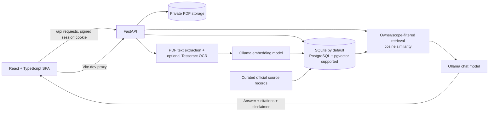

# Vahana — Vehicle Insurance Management and Policy Assistant

An India-focused **Legal-domain Retrieval-Augmented Generation (RAG)** application for organizing motor insurance and understanding policy wording. Vahana keeps a user's vehicles, policies, payments, claims, and uploaded documents together. Its assistant retrieves passages from selected policy documents and curated official sources, includes the user's saved tracker data, and returns explanations with source references.

> **Project status:** Working local prototype. The web application, API, local Ollama generation/embedding path, and scanned-PDF OCR have been exercised end to end. This is an informational tool, not a coverage decision or legal advice.

## Problem

Owners of multiple cars, motorcycles, and scooters can have policies from several insurers, with separate coverage, add-ons, payment records, and renewal dates. Details are spread across policy PDFs, emails, insurer portals, and vehicle apps. After an accident or before changing a vehicle, finding the applicable clause and checking it against the right policy can be difficult.

Vahana combines a private multi-vehicle garage with a searchable policy library. It helps users record what they own, keep policy and claim documents close to their records, track expiry and payment history, and ask questions grounded in those records and selected legal sources.

## Existing apps and the opportunity

Several Indian services already cover parts of this workflow. This comparison summarizes their publicly presented capabilities and does not claim they lack other features.

| Service                                                       | Related capabilities                                                             | Vahana's prototype focus                                                                                                      |
| ------------------------------------------------------------- | -------------------------------------------------------------------------------- | ----------------------------------------------------------------------------------------------------------------------------- |
| [CRED Garage](https://cred.club/garage)                       | Vehicle garage and motor insurance experiences.                                  | Explain the terms in documents a user uploads, across vehicles and insurers, with clause and page references.                 |
| [Policybazaar](https://www.policybazaar.com/insurance-app/)   | Policy management, alerts, comparisons, and insurance services.                  | Organize existing policies independently of where they were purchased, then answer questions from their wording.              |
| [mParivahan](https://mparivahan.parivahan.gov.in/)            | Government vehicle services, including access to insurance validity information. | Complement validity checks with the user's own policy wording, add-ons, payments, and claim notes.                            |
| [PhonePe Insurance](https://www.phonepe.com/insurance/terms/) | Motor insurance purchase journey and AI-assisted explanations.                   | Focus on policy-specific retrieval, traceable evidence, and clear abstention when available records do not answer a question. |

The project demonstrates the combination of a **multi-vehicle policy organizer** and a **citation-backed assistant grounded in policy and legal sources**. It is a prototype, not a replacement for an insurer, government service, or qualified professional.

## Scope, impact, and boundaries

The initial scope is a single-user account workspace for cars, bikes, and scooters, with support for multiple insurers and policies. It aims to reduce time spent locating terms, make renewal and payment records easier to manage, help users compare saved cover, and prepare better-informed questions for their insurer. It also demonstrates document ingestion, retrieval, grounded generation, and citations for the project assignment.

The assistant can explain what the retrieved evidence appears to say about own-damage cover, third-party liability, exclusions, add-ons, modifications, or claim preparation. It cannot decide or guarantee a claim outcome, replace the issued policy, file a claim, buy insurance, or provide legal advice. The insurer's policy and claim assessment remain authoritative.

## Features

### Garage and policy records

- Register, sign in, and sign out with account-scoped records.
- Create, edit, and remove cars, motorcycles, and scooters.
- Add, edit, and remove multiple policies per vehicle, including insurer, policy number, cover type, own-damage and third-party periods, personal accident cover, premium schedule, add-ons, and notes.
- Record, view, and remove premium payments with date, amount, status, and reference.
- View in-app reminders for upcoming or expired coverage and mismatched own-damage/third-party expiry dates.
- Compare coverage and add-ons recorded across vehicles and policies.

### Policy documents and claims

- Upload PDF policy documents and claim attachments; documents are private to their owner.
- Extract text from digital PDFs and use Tesseract OCR for scanned pages when installed.
- Suggest insurer, policy number, dates, and premium from extracted text; let the user review and correct the suggestions.
- Index document chunks for retrieval, retry indexing when the local model was unavailable, download, and remove documents.
- Record claims, update their status, and attach supporting PDFs.
- Keep claim-preparation prompts available in the assistant, including a checklist prompt grounded in the user's policy.

### RAG policy assistant and support

- Ask questions across all policies, one vehicle, or one selected policy.
- Retrieve passages from the selected user's policy documents and seeded official legal/grievance sources.
- Include the selected account tracker context (coverage, premiums, payments, and claim history) in the answer context.
- Return source cards with publisher/title, clause or page location, excerpt, and official link where available.
- Abstain when retrieved material is insufficient and show an informational-use disclaimer.
- Reject clearly unrelated questions and explicit vehicle references that do not match the user's garage; keep evidence tied to its individual vehicle and policy.
- Provide grievance guidance linked to IRDAI's [Bima Bharosa FAQ](https://bimabharosa.irdai.gov.in/Home/FAQ).

The initial curated corpus includes Sections 146–147 of the official [consolidated Motor Vehicles Act, 1988](https://www.indiacode.nic.in/bitstream/123456789/1798/1/eng.pdf) and IRDAI's grievance FAQs. These starter summaries were checked on 2026-11-15; expand and re-check the source set before using the prototype for real decisions.

### Prototype limits

- OCR is configured for English (`eng`) and requires Tesseract on the backend host.
- The curated legal knowledge base is intentionally small and must not be treated as exhaustive or as legal advice.
- The assistant uses a local Ollama chat model and embedding model. Answers require both to be installed and running; API and retrieval behavior can be tested with a fake model client.
- Reminders are displayed in the app; email, push, calendar, payment, insurer, and claims-portal integrations are not implemented.
- The app currently creates its schema at startup with SQLAlchemy `create_all`; schema migrations and a production deployment stack are not configured.

## Architecture



### Main request and data flows

1. The React app sends same-origin `/api` requests through Vite during development. FastAPI uses a signed session cookie and checks record ownership on protected endpoints.
2. A policy PDF is size/signature checked, stored under a random server-side name, read page by page, and optionally OCRed. Suggested fields are saved for user review.
3. The document is split on section headings and paragraph boundaries, retaining the heading and page number with each chunk. Long paragraphs use a sentence/word-boundary fallback with a size cap and small overlap. Ollama generates 768-dimensional embeddings; chunks are stored with their owner and document/source association. If Ollama is unavailable, extracted text remains stored and indexing can be retried.
4. For a question, the API selects the relevant global official sources and only that user's documents in the chosen scope. It ranks chunk embeddings by cosine similarity and adds a snapshot of that user's saved tracker records.
5. Ollama receives the retrieved evidence with citation markers. The API returns the answer, source metadata and excerpts, an insufficient-evidence flag, and the informational disclaimer.

## Technology stack

| Layer                    | Technology                                                                              |
| ------------------------ | --------------------------------------------------------------------------------------- |
| Frontend                 | React 18, TypeScript, Vite, React Router, Lucide icons                                  |
| API                      | Python 3.10+, FastAPI, Pydantic                                                         |
| Persistence              | SQLAlchemy 2; SQLite for local development/tests; PostgreSQL with pgvector type support |
| Retrieval and generation | Ollama REST API; `nomic-embed-text` embeddings and `qwen3:4b-instruct` chat by default  |
| PDF processing           | PyMuPDF; optional Pillow and Tesseract OCR                                              |
| Authentication           | Argon2 password hashing and signed Starlette session cookie                             |
| Tests and checks         | pytest, Ruff, Vitest, React Testing Library, TypeScript build, ESLint, Prettier         |

## Database overview

SQLAlchemy models are declared in `backend/app/models.py`.

| Table               | Purpose                                                                           |
| ------------------- | --------------------------------------------------------------------------------- |
| `users`             | Account and password hash.                                                        |
| `vehicles`          | Owner-scoped garage entries.                                                      |
| `policies`          | Insurer, cover types, coverage dates, premium schedule, add-ons, and notes.       |
| `premium_payments`  | User-entered premium payment history.                                             |
| `claims`            | Incident description, status, dates, amount, and notes.                           |
| `policy_documents`  | Stored PDF metadata, extraction state, review suggestions, and claim association. |
| `knowledge_sources` | Curated public legal and grievance sources.                                       |
| `knowledge_chunks`  | Page/section chunks, owner/source association, and optional embeddings.           |

## API overview

All routes are under `/api`; interactive OpenAPI documentation is available at `/docs` while the backend is running.

| Route group        | Endpoints                                                                                              |
| ------------------ | ------------------------------------------------------------------------------------------------------ |
| Authentication     | `POST /auth/register`, `POST /auth/login`, `POST /auth/logout`, `GET /auth/me`                         |
| Garage and records | `/vehicles`, `/policies`, `/claims`, `/payments` (`GET`, `POST`, `PATCH`, and `DELETE` as appropriate) |
| Documents          | Policy/claim PDF upload; list, review, re-index, download, and delete document routes                  |
| Dashboard/support  | `GET /dashboard`, `GET /coverage-comparison`, `GET /grievance-guidance`                                |
| Assistant          | `POST /assistant/ask` with optional `vehicle_id` or `policy_id` scope                                  |
| Health             | `GET /health`                                                                                          |

## Repository structure

```text
.
├── AGENTS.md
├── README.md
├── backend/
│   ├── app/
│   │   ├── api/             # FastAPI route modules and auth dependency
│   │   ├── core/            # Settings and password security
│   │   ├── knowledge/       # Curated seed sources
│   │   ├── services/        # PDF ingestion, Ollama, RAG, knowledge seeding
│   │   ├── db.py            # SQLAlchemy engine/session/vector type
│   │   ├── models.py        # Database schema
│   │   ├── schemas.py       # Request/response validation
│   │   └── main.py          # FastAPI app and startup
│   ├── tests/               # Backend API and RAG tests
│   ├── .env.example
│   ├── pyproject.toml
│   └── requirements.txt
└── frontend/
    ├── src/
    │   ├── components/      # Shared layout and UI controls
    │   ├── lib/             # API client, auth context, types, formatting
    │   ├── pages/            # Dashboard, garage, policies, claims, assistant, etc.
    │   └── styles.css
    ├── package.json
    └── vite.config.ts
```

## Local setup

### Prerequisites

- Python 3.10 or later and Node.js/npm.
- [Ollama](https://ollama.com/download) for live assistant answers and policy indexing.
- Tesseract OCR only if scanned PDFs need to be read. It must include English (`eng`) language data. Set `TESSERACT_CMD` in `backend/.env` if its executable is not on `PATH`.

### Configure and install

In PowerShell from the repository root:

```powershell
Copy-Item backend\.env.example backend\.env
cd backend
python -m venv .venv
.\.venv\Scripts\Activate.ps1
python -m pip install -r requirements.txt
```

Set a unique `SESSION_SECRET` in `backend/.env`. SQLite and private PDF files use local paths under the backend working directory by default. For PostgreSQL, set `DATABASE_URL` to a PostgreSQL DSN; the database user must be allowed to create the `vector` extension. The Postgres vector column currently expects 768-dimensional embeddings.

Install frontend dependencies in a second PowerShell window from the repository root:

```powershell
cd frontend
npm ci
```

Install/start Ollama, then download the configured models:

```powershell
ollama pull qwen3:4b-instruct
ollama pull nomic-embed-text
```

Ollama listens at `http://localhost:11434` by default. Model tags can be changed in `backend/.env`.
On Windows, if Tesseract is not on `PATH`, set `TESSERACT_CMD=C:\Program Files\Tesseract-OCR\tesseract.exe` in `backend/.env`.

### Run locally

Start the API from `backend/` with its virtual environment active:

```powershell
python -m uvicorn app.main:app --reload
```

Start the website from `frontend/` in another terminal:

```powershell
npm run dev
```

Open [http://localhost:5173](http://localhost:5173). The backend health endpoint is [http://localhost:8000/api/health](http://localhost:8000/api/health), and API docs are at [http://localhost:8000/docs](http://localhost:8000/docs).

### Tests and quality checks

Run backend commands from `backend/` with `.venv` active:

```powershell
python -m pytest
python -m ruff check app tests
python -m ruff format --check app tests
```

Run frontend commands from `frontend/`:

```powershell
npm test
npm run lint
npm run format:check
npm run build
npm audit --audit-level=moderate
```

The checked-in suite has 25 backend tests and 10 frontend tests. It covers account and record APIs, ownership isolation, document upload/review/cleanup and OCR configuration, date extraction, heading-aware policy chunking, dashboard/comparison, assistant API integration, RAG citations/abstention/tracker context and out-of-scope input handling, Ollama REST request handling with a fake HTTP client, and authentication, garage, policy-payment, claim, dashboard, comparison, support, and assistant UI interactions. The OCR unit test uses mocked recognition text for repeatability; the installed Tesseract engine was also exercised against a synthetic scanned policy PDF. Live Ollama checks confirmed 768-dimensional embeddings and a grounded answer containing its citation marker. In the verified checkout, all listed backend and frontend tests, lint and format checks, the production build, and dependency audit passed.

## Configuration and data safety

- `backend/.env.example` lists supported settings. Environment variables override defaults; local `.env` files are ignored by Git.
- Set a random `SESSION_SECRET` for persistent development sessions. Production requires it; set `COOKIE_SECURE=true` behind HTTPS and restrict `CORS_ORIGINS` to the app's origin.
- Do not commit real policy/claim PDFs, personal information, database files, credentials, or secrets. Use synthetic or redacted sample documents.
- Uploaded PDFs are stored outside the web root and served through an owner-checked endpoint. Keep the data directory private and back it up only using appropriate access controls.

## Deployment status

The repository currently documents and supports a local development/demo setup. It does not include a container stack, production web server configuration, automated backups, email delivery, or schema migration tooling. Before public deployment, add a migration path, HTTPS and secure cookie configuration, managed PostgreSQL and private object storage, backup/retention rules, monitoring, rate limiting, and a security review.
